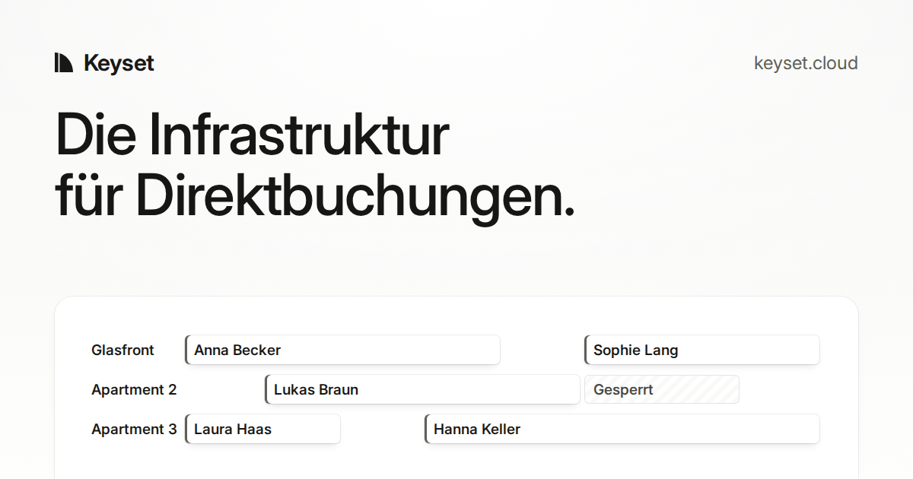
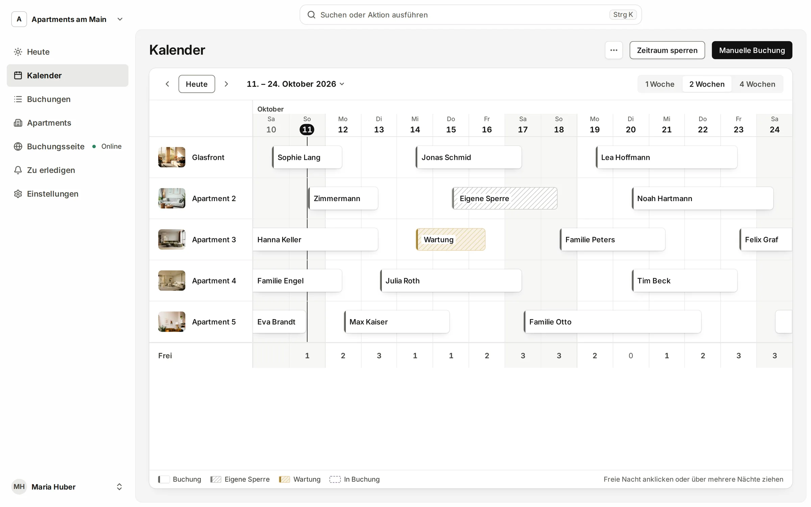
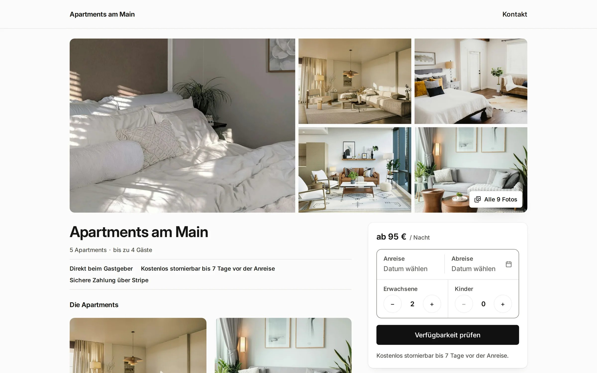
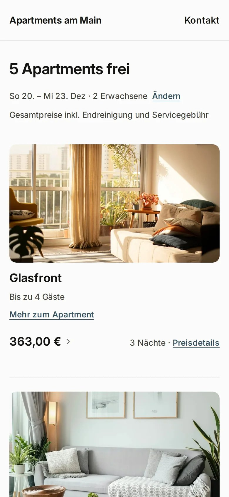

# Keyset – das Buchungssystem für Ferienwohnungen

**Keyset ist Buchungssoftware für Gastgeber mit einigen Ferienwohnungen:** eine eigene Buchungsseite, ein Kalender für
alle Wohnungen und Kartenzahlung direkt aufs eigene Konto – **ohne Provision an Portale**.

[**keyset.cloud**](https://keyset.cloud/?utm_source=github&utm_medium=profile) ·
[Preise](https://keyset.cloud/preise/?utm_source=github&utm_medium=profile) ·
[Gemeinsam einrichten](https://keyset.cloud/einrichten/?utm_source=github&utm_medium=profile) ·
[Kostenlos registrieren](https://app.keyset.cloud/sign-up?utm_source=github&utm_medium=profile)

---

## Was Keyset macht

- 🗓️ **Ein Kalender für alle Wohnungen**: Wer wann in welcher Wohnung wohnt, auf einer Seite – Buchungen, eigene Sperren und Wartung.
- 🌐 **Deine eigene Buchungsseite**: Gäste buchen direkt bei dir, auf dem Handy wie am Rechner.
- 💳 **Das Geld direkt auf deinem Konto**: Gäste zahlen mit Karte über dein eigenes Stripe-Konto. Keyset schlägt auf die Stripe-Gebühr nichts auf.
- 🔄 **Abgleich mit Airbnb und Booking.com**: Belegte Nächte gleichen sich regelmäßig mit den Portalen ab. Keyset ist kein Channel Manager: Preise und Verfügbarkeit dort steuert es nicht.
- 🇪🇺 **Daten in der EU**: Die Daten liegen auf Servern in der EU.

<table>
  <tr>
    <td width="68%">
      
    </td>
    <td width="32%">
      
    </td>
  </tr>
</table>

## Preise

**19 € im Monat** für die erste Wohnung, jede weitere **6 €**, ab der elften **4 €** – inklusive Mehrwertsteuer,
monatlich kündbar, keine Provision.
→ [Alle Preise](https://keyset.cloud/preise/?utm_source=github&utm_medium=profile)

## Kostenlose Werkzeuge für Gastgeber

- [**Airbnb-Gebührenrechner**](https://keyset.cloud/airbnb-gebuehr-rechner/?utm_source=github&utm_medium=profile) –
  was nach 15,5 % Airbnb-Gebühr bleibt, im Vergleich zu Booking.com und einer direkten Buchung.
- [**Kurtaxe je Ort**](https://keyset.cloud/kurtaxe/?utm_source=github&utm_medium=profile) – Kurtaxe, Kurbeitrag,
  Gästebeitrag und Übernachtungsteuer je Gemeinde, jede Zahl mit dem Wortlaut der Satzung, dazu ein Rechner je Ort.
- [**Kurtaxe als offene Daten**](https://keyset.cloud/kurtaxe/api/?utm_source=github&utm_medium=profile) – alle Orte
  als JSON und CSV unter CC BY 4.0, mit den Rechenregeln.
- [**Direktbuchung neben Airbnb und Booking.com**](https://keyset.cloud/direktbuchung/?utm_source=github&utm_medium=profile)
  – Leitfaden zu Kosten, Regeln der Portale, Kalenderabgleich und Stornobedingungen.
- [**Keyset oder Smoobu?**](https://keyset.cloud/vergleich/smoobu/?utm_source=github&utm_medium=profile) – Preise und
  Funktionen im Vergleich.

## Über Keyset

Keyset ist ein Produkt von Verge-One, Haßfurt – gegründet und gebaut von
[Dominik Lenhart](https://github.com/dominik-lenhart).
→ [Über Keyset](https://keyset.cloud/ueber-keyset/?utm_source=github&utm_medium=profile)

<a href="https://keyset.cloud/impressum/">Impressum</a> · <a href="https://keyset.cloud/datenschutz/">Datenschutz</a>
